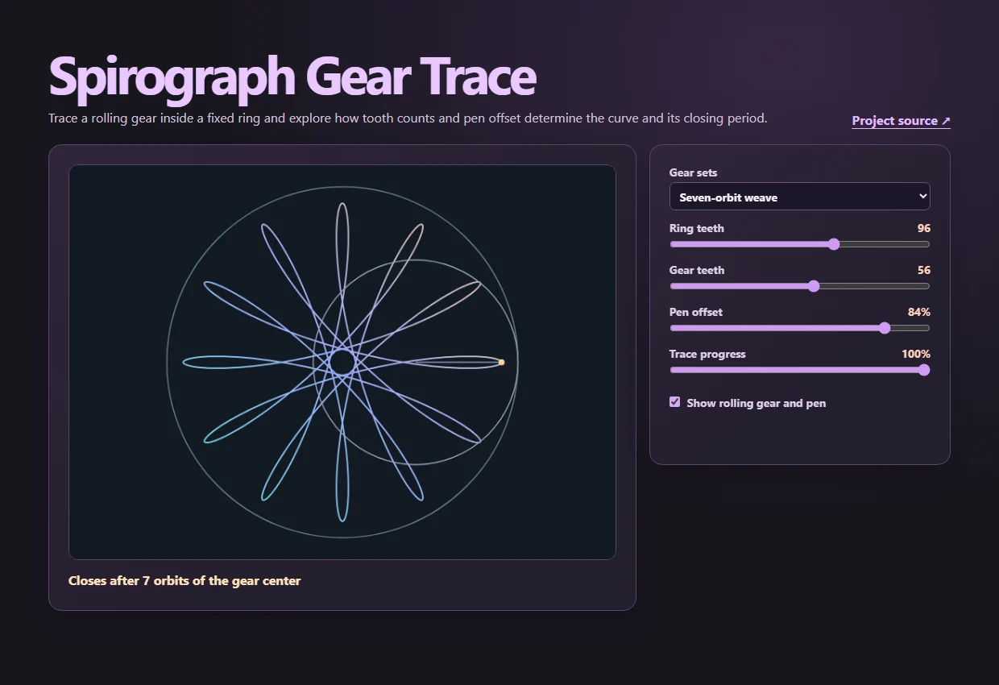

# Spirograph Gear Trace

Trace a rolling gear inside a fixed ring and explore how tooth counts and pen offset determine the curve and its closing period.

[Open the browser app](https://surfingcoder.com/apps/spirograph-gear-trace/)

## Run locally

Run the following command in this repository and open [localhost:8000](http://localhost:8000).

    python -m http.server 8000

The gear rolls inside the ring without slipping. Scrub trace progress to follow the pen, or hide the guide to inspect the finished curve. A zero-offset pen follows the gear center. Tooth counts use a common pitch.

## Verify

Run the following command with Node.js 22 or newer.

    node --test
